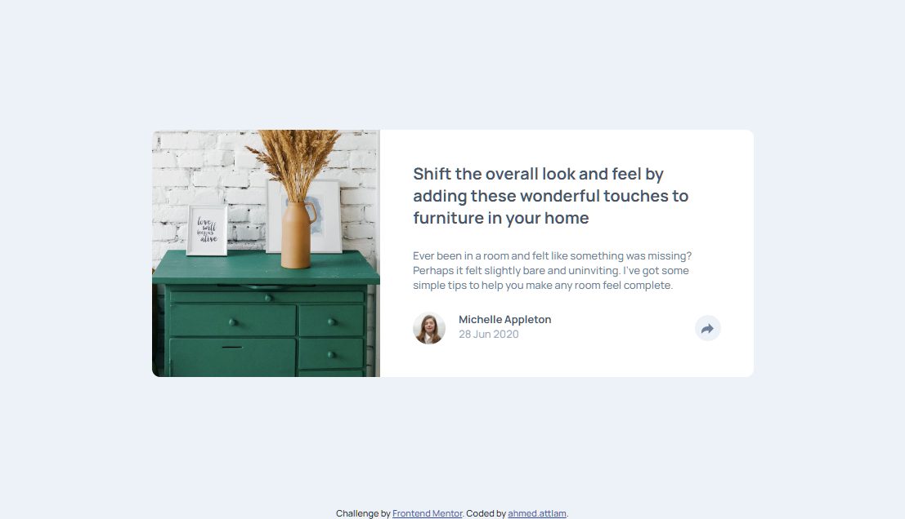

# Frontend Mentor - Article preview component solution

This is a solution to the [Article preview component challenge on Frontend Mentor](https://www.frontendmentor.io/challenges/article-preview-component-dYBN_pYFT).

### The challenge

Users should be able to:

- View the optimal layout for the component depending on their device's screen size
- See the social media share links when they click the share icon

### Screenshot

### Links

- Solution URL: [Repo-link](https://github.com/ahmedattlam10/Article-preview-component)
- Live Site URL: [Demo-link](https://ahmedattlam10.github.io/Article-preview-component/)

### Built with

- Semantic HTML5 markup
- CSS custom properties
- Flexbox
- CSS Grid
- Mobile-first workflow
- Vanilla JavaScript

## Author

- Website - [Github-profile](https://github.com/ahmedattlam10)
- Frontend Mentor - [FM-profile](https://www.frontendmentor.io/profile/ahmedattlam10)
